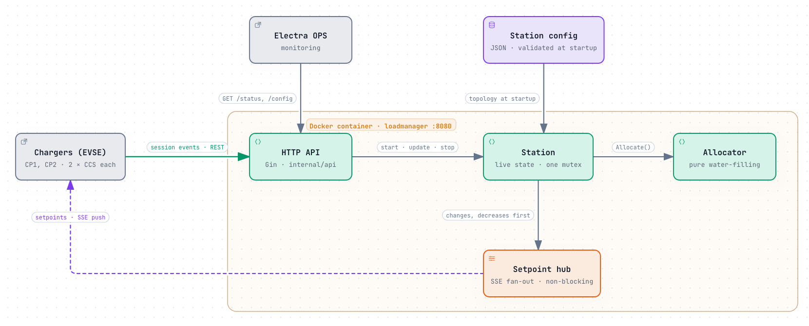
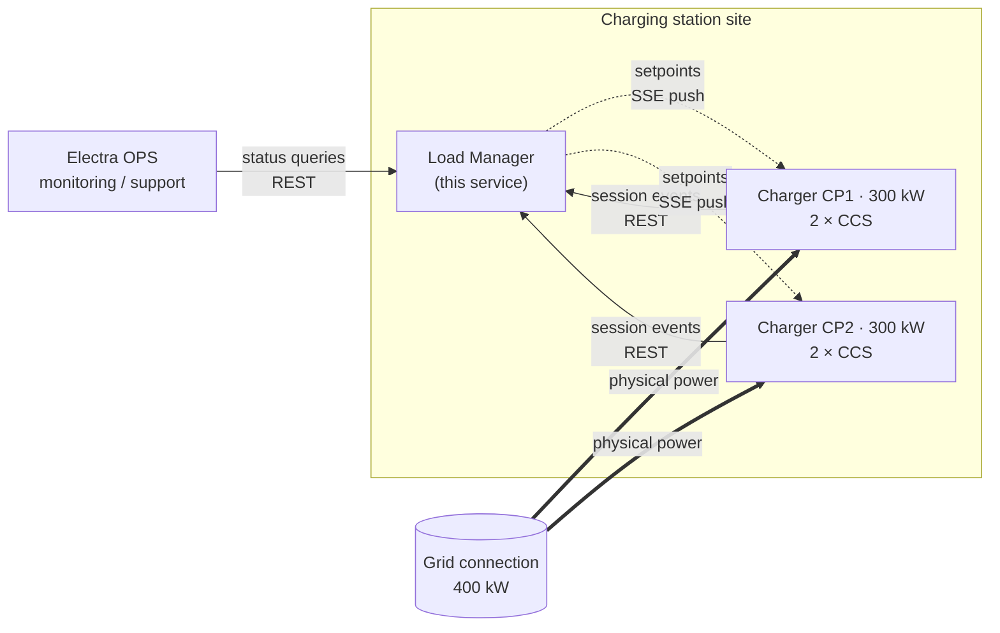
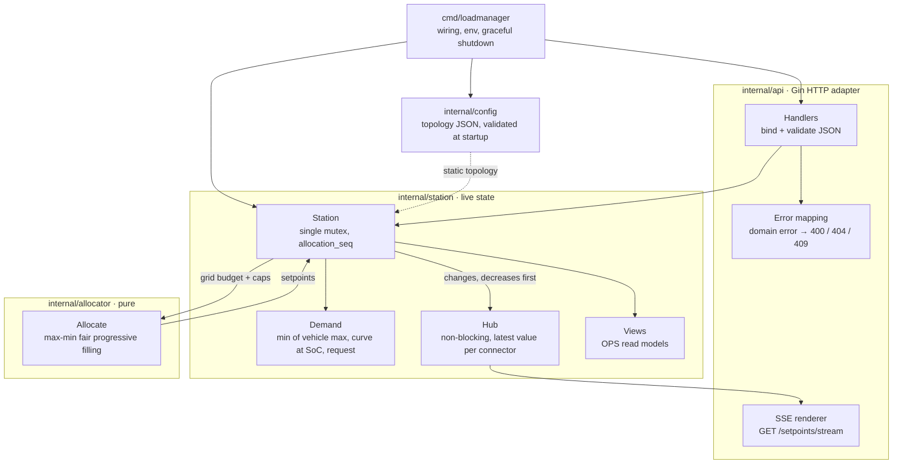
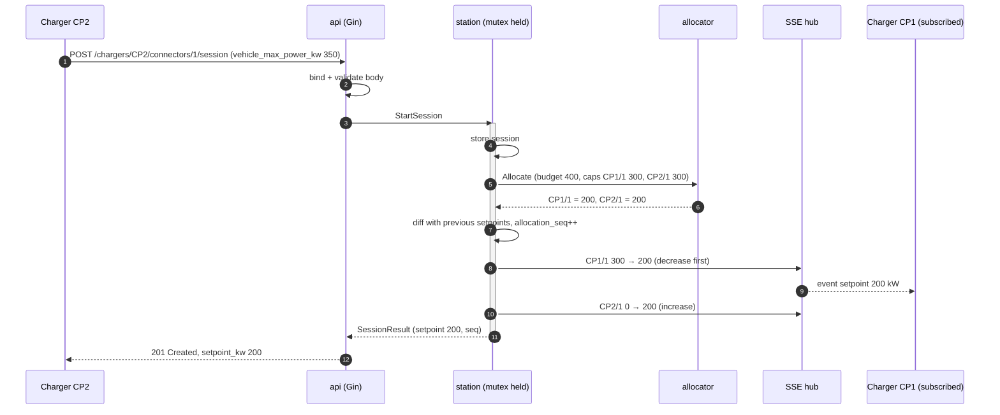
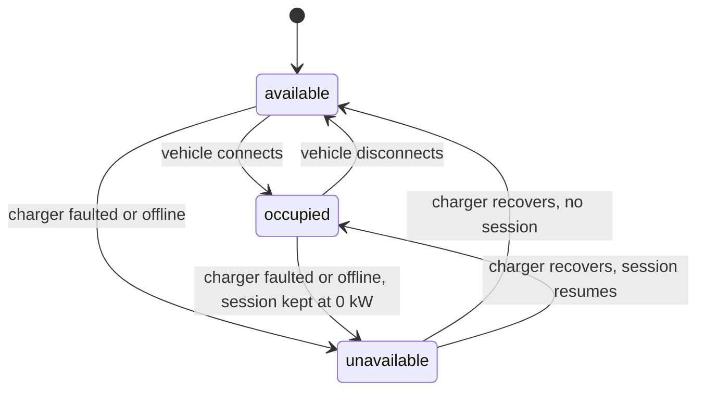

# Station Load Manager

The "brain" of an EV charging station. It shares the station's grid capacity across concurrent charging sessions in real time. It respects the grid, charger, connector and vehicle limits, including charging curves.

- **Go 1.25 + Gin**, a single static binary in a distroless Docker image.
- **Event → new setpoints in ~0.1 ms** (p99 ≈ 0.2 ms, measured in tests). The requirement is < 1 s.
- **Max-min fair allocation** across sessions, proven by table tests and a 1000-case property test.
- **Setpoint push over SSE**, so a charger learns its setpoint changed even when another charger's event caused it.

---

## Quickstart

```bash
# Run the service (port 8080, using the example station from the brief)
docker compose up --build

# In another terminal: run the 5 end-to-end scenarios (bash + curl only)
make e2e                                  # BASE_URL=http://host:port make e2e for another host

# Unit, property, API, SSE and latency tests (needs Go 1.25+)
make test          # go vet + go test -race ./...
make test-v        # verbose, prints the latency measurement
```

To use a different station topology without rebuilding:

```bash
STATION_CONFIG=ac-depot.json docker compose up      # 6 × 22 kW AC on a 66 kW grid
```

To run without Docker, use `make run`, or `CONFIG_PATH=configs/ac-depot.json go run ./cmd/loadmanager`.

| Env var | Default | Purpose |
|---|---|---|
| `CONFIG_PATH` | `configs/example-station.json` | station topology |
| `LISTEN_ADDR` | `:8080` | listen address |
| `GIN_MODE` | `release` | set it to `debug` for Gin route logs |

---

## Architecture



Chargers send their events synchronously through the HTTP API. The Station reshares the power under a single lock using the pure Allocator. The chargers that didn't send the event get their new setpoint asynchronously from the setpoint hub, over SSE. The sections below go into each part in detail.

### Design principles

| Principle | How it shows up | Why it matters here |
|---|---|---|
| **Pure core, thin shell** | The allocation algorithm is a pure function with no I/O, locks or clock. HTTP, state and push are layered around it. | The safety-critical logic can be tested exhaustively, including the property test, without starting a server. |
| **One writer, total order** | All events go through one mutex: validate → mutate → reallocate → publish. | Setpoints are always consistent with the state, and events and pushes have a single order. |
| **Sync in, async out** | A charger's event gets its own setpoint in the HTTP response. The other chargers are told over SSE. | The caller gets an immediate yes or no, and the chargers that didn't send anything still learn about changes in under 1 s. |
| **Safe by construction** | Decreases are published before increases, and unavailable chargers get 0 kW. | The grid limit holds even while chargers apply new setpoints. |
| **Fail fast at the edges** | Config and request bodies are validated strictly, and unknown fields are rejected. | A typo can't silently become a 0 kW limit or an unlimited one. |

### 1. System context

What the service talks to. The grid connection is a limit the service respects, not something it controls.



### 2. Components

How the code is organised. Dependencies point inward: `api` → `station` → `allocator`. Nothing in the core imports HTTP or Gin.



| Package | Responsibility | Depends on |
|---|---|---|
| `internal/config` | Parses and validates the station topology, and fails fast on bad config | stdlib |
| `internal/allocator` | The algorithm. Pure and deterministic: no I/O, no locks, no time | stdlib |
| `internal/station` | Live state, event handling, rebalance, diff, SSE fan-out | allocator, config |
| `internal/api` | HTTP adapter (Gin): binding, validation, status codes, SSE rendering | station |
| `cmd/loadmanager` | Wiring, env config, graceful shutdown | all |

### 3. Event flow: a second car arrives

Car B connects on CP2. CP1 sent nothing, but its setpoint drops from 300 to 200 kW and it is told over SSE. The decrease goes out before the increase.



The whole path takes about 0.1 ms. No queue is involved, so there's no backlog and no "accepted but not yet applied" state.

### 4. Connector lifecycle

The status OPS sees for each connector. When a charger faults, its sessions are kept at 0 kW, and they resume when the charger is available again.



### 5. Deployment

| Aspect | Choice |
|---|---|
| Unit | One container per station, single static binary (`CGO_ENABLED=0`) |
| Image | Multi-stage build: `golang:1.25-alpine` to compile, `distroless/static:nonroot` to run, with no shell, as a non-root user |
| Config | JSON topology mounted read-only and selected with `CONFIG_PATH` (`STATION_CONFIG` in compose) |
| State | In memory, rebuilt by chargers re-reporting after a restart (see trade-offs) |
| Shutdown | SIGTERM cancels the request contexts, so SSE streams close and `http.Server.Shutdown` drains cleanly |
| Observability | Structured JSON logs (`slog`): one line per request and one per rebalance, with its duration in µs |

---

## Allocation algorithm

**Policy: hierarchical max-min fairness ("water-filling").**

The limits form a tree: grid (minus safety margin) → charger → session, where a session's cap is `min(vehicle demand, connector max)`.

Every session gets an equal share, except sessions that are capped lower by their vehicle, connector or a saturated charger. The power those sessions can't use is redistributed to the others.

**Implementation: progressive filling** ([allocator.go](internal/allocator/allocator.go)).

1. All unfrozen sessions are raised together by the largest step δ that breaks no limit. δ is the smallest of:
   - each session's remaining cap;
   - each charger's remaining capacity divided by its number of unfrozen sessions;
   - the grid's remaining capacity divided by the total number of unfrozen sessions.
2. Whatever became tight is frozen: the sessions at their cap, all sessions of a saturated charger, or everyone if the grid is exhausted.
3. Each round freezes at least one session or charger, so it ends in at most `sessions + chargers + 1` rounds. That is O(n·(n+k)) and exact, with no binary search and no tuning.

Worked example (600 kW grid, 2 × 300 kW chargers, three cars wanting 300 kW):

| Car | Equal split | Final | Why |
|---|---|---|---|
| CP1/1 | 200 | **150** | CP1 is limited to 300 kW, shared by 2 cars |
| CP1/2 | 200 | **150** | same |
| CP2/1 | 200 | **300** | gets the 100 kW CP1 couldn't use |

---

## How the service behaves

Every car gets an equal share of the grid, with no priorities, and every event reshares the power straight away. A car is limited by the lowest of its own maximum, its charging curve at the reported battery level, any power cap the driver asks for, and its connector and charger limits. Two connectors on one charger share that charger's power. Whatever a car can't use goes to the others, and setpoints are rounded down to 0.1 kW.

The charger reports the battery level; the service never simulates charging. A charger's own event gets its new setpoint in the reply, and the other chargers are told over SSE. A faulted or offline charger keeps its sessions at 0 kW until it recovers, and its power goes to the healthy ones.

The station layout is read from a JSON file at startup, and the service refuses to start if the file is invalid. State lives in memory. Battery storage (BESS), priorities, a minimum power per car and authentication are out of scope.

---

## API reference

Base URL: `http://localhost:8080`. All bodies are JSON. Unknown fields are rejected, and errors are returned as `{"error": "..."}`.

### Charger → station events

| Method & path | Body | Success | Errors |
|---|---|---|---|
| `POST /chargers/{cid}/connectors/{n}/session` | `vehicle_max_power_kw` (required, > 0), `charging_curve?`, `soc_pct?` (0–100), `requested_power_kw?` (≥ 0) | **201** | 400 invalid · 404 unknown charger/connector · 409 occupied or charger unavailable |
| `PATCH /chargers/{cid}/connectors/{n}/session` | `soc_pct?`, `requested_power_kw?` (at least one) | **200** | 400 · 404 no session |
| `DELETE /chargers/{cid}/connectors/{n}/session` | — | **200** | 404 no session |
| `POST /chargers/{cid}/status` | `{"status": "available" \| "faulted" \| "offline"}` | **200** (charger view) | 400 · 404 |

All session events return the caller's new setpoint:

```json
{"charger_id":"CP2","connector_id":"1","demand_kw":350,"setpoint_kw":200,"allocation_seq":2}
```

### Station → charger setpoint push (SSE)

`GET /setpoints/stream[?charger_id=CP1]`. The stream sends one `snapshot` event per connector first, then one `setpoint` event per change. Every 15 s it sends a `: keepalive` comment line.

```
event:snapshot
id:0
data:{"allocation_seq":0,"charger_id":"CP1","connector_id":"1","setpoint_kw":0}

event:setpoint
id:2
data:{"allocation_seq":2,"charger_id":"CP1","connector_id":"1","setpoint_kw":200}
```

Each subscriber keeps only the **latest pending setpoint per connector**. A slow client is never disconnected, and it never receives stale intermediate values: when it reads, it gets the current value of each changed connector, with decreases first relative to what it last received. Publishing never waits, so a slow client can't stall the allocator. If the connection drops, the client reconnects and resyncs from the snapshot.

### OPS queries

| Method & path | Returns |
|---|---|
| `GET /status` | Station totals plus every charger, connector and session. The totals are `grid_capacity_kw`, `effective_capacity_kw`, `allocated_kw`, `headroom_kw`, `unserved_demand_kw` (> 0 means the station is power-constrained), `active_sessions` and `allocation_seq`. |
| `GET /chargers/{cid}` | The charger's status, its allocated kW, and its connectors |
| `GET /chargers/{cid}/connectors/{n}` | Connector `status` (`available` / `occupied` / `unavailable`), `setpoint_kw`, and session details (demand, SoC, curve, timestamps) |
| `GET /config` | The loaded station topology |
| `GET /healthz` | Liveness |

### curl walkthrough

```bash
# Car A connects alone → 300 kW (charger limit)
curl -s -X POST localhost:8080/chargers/CP1/connectors/1/session \
  -H 'Content-Type: application/json' -d '{"vehicle_max_power_kw": 350}'

# Car B with a charging curve at 20 % SoC
curl -s -X POST localhost:8080/chargers/CP2/connectors/1/session \
  -H 'Content-Type: application/json' -d '{
    "vehicle_max_power_kw": 300, "soc_pct": 20,
    "charging_curve": [{"soc_pct":0,"max_power_kw":150},{"soc_pct":80,"max_power_kw":50},{"soc_pct":100,"max_power_kw":10}]
  }'

# Car B reports a new SoC → demand follows the curve, A picks up the slack
curl -s -X PATCH localhost:8080/chargers/CP2/connectors/1/session \
  -H 'Content-Type: application/json' -d '{"soc_pct": 90}'

# Watch the setpoints live (in another terminal)
curl -N localhost:8080/setpoints/stream

# OPS view
curl -s localhost:8080/status
```

---

## Station configuration

```json
{
  "station_id": "example-dc-hub",
  "grid_capacity_kw": 400,
  "safety_margin_kw": 0,
  "chargers": [
    { "id": "CP1", "max_power_kw": 300,
      "connectors": [ { "id": "1", "type": "CCS" }, { "id": "2", "type": "CCS", "max_power_kw": 200 } ] }
  ]
}
```

The service validates the config at startup and refuses to start if any check fails. It reports every error at once. The checks are:
- the grid capacity and every charger max are positive;
- `0 ≤ margin < grid`;
- charger ids are unique, and connector ids are unique within their charger;
- every charger has at least one connector;
- no connector max is above its charger max;
- the file has no unknown fields, so a typo can't silently become 0.

Two configs ship with the project:
- [configs/example-station.json](configs/example-station.json): the brief's example, a 400 kW grid with 2 × 300 kW chargers of 2 CCS connectors each.
- [configs/ac-depot.json](configs/ac-depot.json): 6 × 22 kW Type 2 chargers on a 66 kW grid with a 2 kW margin. One connector is limited to 11 kW.

---

## Test scenarios

### Automated (`make test`)

| Scenario | Where | What it validates | Why I chose it |
|---|---|---|---|
| Lone car takes all, capped at 300 | allocator, station, api | A car never gets more than its charger | First case in the brief |
| Second car → 200 / 200 | allocator, station, api | Sharing, and the first car's setpoint drops | Core brief behaviour |
| First car leaves → 300 | allocator, station, api | Freed power is reallocated | Core brief behaviour |
| Car wants only 100 → 300 / 100 | allocator | Surplus is redistributed | Without this, capacity is wasted |
| 600 kW grid, 2 cars on CP1, 1 on CP2 → 150/150/300 | allocator | Charger limit is shared and leftover goes elsewhere | Proves fairness is per session and that the charger limit is respected |
| All 4 connectors → 100 each | allocator | Grid is the only bottleneck | Fully loaded station |
| Grid above total demand | allocator | Nobody gets more than they asked for | A car never gets more than it requested |
| Zero demand / NaN / negative caps | allocator | 0 kW, no share taken, no crash | Car at 100 %, or bad data |
| No sessions | allocator | No division by zero | Empty station |
| 400 / 3 → 133.3 each | allocator, scenario 03 | Rounding down keeps the sum ≤ grid | A rounding error must never exceed the grid limit |
| Vehicle cap, then charger cap, then grid | allocator | Every freeze rule in one run | Exercises every limit type in a single allocation |
| **1000 random stations (property test)** | allocator | Sum ≤ grid; per charger ≤ max; per session ≤ cap; **max-min optimality**: an under-served session sits behind a saturated charger or grid and gets ≥ every peer on that bottleneck | Shows the rules hold in general, beyond the hand-picked examples |
| Curve interpolation, clamping, min with request | station | Demand calculation | Charging curves are explicitly in the brief |
| Curve taper redistributes | station, api | A tapering car's surplus goes to the others | How demand changes during a real session |
| Charger fault, then recovery | station, api | 0 kW, its power redistributed, 409 for new sessions, then recovery | A failed charger must not keep power reserved |
| Decreases published before increases | station | Event order within one rebalance | The station stays under the grid limit even while setpoints change |
| Snapshot + charger filter on subscribe | station | No missed events, no leaks between chargers | A charger must never miss its own update |
| Slow subscriber gets the latest value only | station | After 2000 unread events, the reader gets one current value per changed connector, with no drop and no blocking | A slow client can't freeze the allocator, and never acts on a stale setpoint |
| Catch-up ordering | station | Across coalesced rebalances, decreases still come before increases, judged against what that reader last received | A client catching up stays under the grid limit too |
| `allocation_seq` monotonic | station | Chargers can discard stale updates | Updates can arrive out of order |
| Concurrent events from 8 goroutines (`-race`) | station | No data races, invariant holds | Real chargers send events at the same time |
| 19 invalid requests → 400/404/405/409 | api | Validation and error mapping | Input from the field is not trustworthy |
| **SSE: CP2 event pushes to CP1** | api | Async notification over a real HTTP server | Answers "how does a charger learn about a change it didn't cause?" |
| **Latency over 1000 events** | api | p99 < 50 ms asserted (measured p50 ≈ 90 µs, p99 ≈ 200 µs) | Evidence for the < 1 s requirement |
| Invalid configs rejected, shipped configs valid | config | Fail fast | A wrong grid limit is a safety issue |

### End-to-end against the running service (`make e2e`)

These scenarios are black-box tests: they talk to the running service over HTTP, as a charger or OPS would, so they also cover the binary, the port and the config loaded at startup. They use only bash and curl, so there is nothing to install. Each one checks its own results and prints ✔ or ✘, so there's no JSON to read by eye. Run `make e2e` (or `./scenarios/run-all.sh`), and set `BASE_URL` to target another host.

| Scenario | What it shows |
|---|---|
| `01-brief-flow.sh` | Lone car → 300; second car → 200/200; first leaves → 300; OPS headroom |
| `02-vehicle-limits-and-curve.sh` | Curve-limited car (150 → 100 → 30 as SoC rises) and redistribution to the other car, then a driver cap of 120 kW |
| `03-full-station-and-charger-sharing.sh` | 3 cars → 133.3 each; 4 cars → 100 each with unserved demand visible to OPS; 2 cars on one charger → 150/150 |
| `04-charger-fault.sh` | Fault → 0 kW and redistribution → 409 for a new session → recovery → 200/200; invalid inputs |
| `05-sse-push.sh` | A live SSE subscriber gets CP1's lowered setpoint when a car connects on CP2, with the decrease published before the increase |

---

## Trade-offs

| Choice | Why | Cost |
|---|---|---|
| **In-memory state, no database** | Chargers are the source of truth for live sessions, so a saved snapshot is stale after any downtime. There's no database write on the safety-critical path. | After a restart, the service knows nothing until the chargers re-report. |
| **One mutex for all events** | Allocation takes microseconds, and the lock gives a single total order: setpoints always match the state, and events go out in allocation order. | Doesn't scale past one station per process, which is all it needs. |
| **SSE for the push** | One-way is all that's needed. It's plain HTTP, can be demoed with `curl -N`, and needs no callback URLs or retries. | One open connection per charger. |
| **Synchronous events, no queue** | Reallocation is cheap enough to run inline, and the charger gets an immediate yes or no. | None at station scale. |
| **Fairness per session, not per charger** | Fairer to drivers: two cars on a dual charger don't each get less than a car charging alone. | None. |
